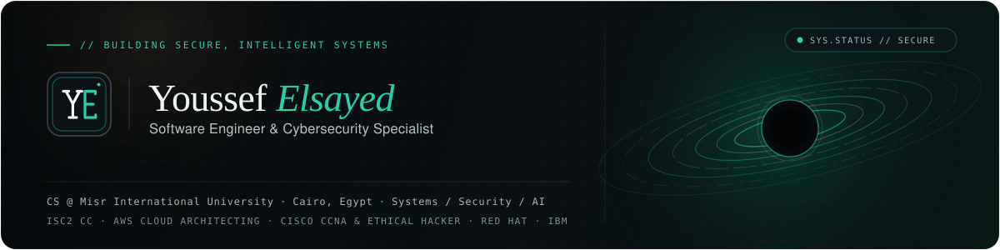

  <a href="https://youssef-elsayed-portfolio.vercel.app" target="_blank" rel="noopener noreferrer">
    <picture>
      <source media="(prefers-color-scheme: dark)" srcset="./assets/banner-dark.svg" />
      <source media="(prefers-color-scheme: light)" srcset="./assets/banner-light.svg" />
      
    </picture>
  </a>

 

  
  
  
  
  
  

 

> *"I break things to understand how to build them more securely."*

I'm **Youssef Elsayed**, a Computer Science student at **Misr International University** (Cybersecurity Specialization) building resilient software, hardened network & Linux architectures, and practical AI/ML systems.

- **Currently Building:** [**Thenar**](https://github.com/youssef5520055/thenar) — fingerprint-gated behavioral smart safe handle using grip-force & motion dynamics *(MIU Graduation Project 2026)*
- **Core Focus:** Cybersecurity & Network Defense, Linux & Cloud Hardening, Applied Machine Learning, and Full-Stack Engineering
- **Deepening Expertise:** SOC Engineering, Penetration Testing, Cloud & Kubernetes Security, and Reverse Engineering
- **Open To:** Cybersecurity internships, software engineering roles, DevSecOps collaborations, and security-focused open source

---

### Core Engineering Domains

<table>
  <tr>
    <td width="50%" valign="top">
      <h4>Cybersecurity &amp; Network Defense</h4>
      
Vulnerability assessment, ethical hacking principles, incident response, enterprise VLAN/OSPF topologies, firewall policy design, and web application hardening (CSP, HSTS, SAST, supply-chain auditing).

    </td>
    <td width="50%" valign="top">
      <h4>AI &amp; Machine Learning</h4>
      
End-to-end Python ML pipelines with Scikit-learn, NumPy, and Pandas — feature engineering, multi-model classification benchmarking, behavioral signal analysis, and real-time voice detection.

    </td>
  </tr>
  <tr>
    <td width="50%" valign="top">
      <h4>Cloud &amp; Linux Infrastructure</h4>
      
Ubuntu Server &amp; Red Hat Enterprise Linux administration, SSH &amp; POSIX hardening, AWS cloud architecture (EC2, VPC, IAM, S3), Docker &amp; Kubernetes security, Apache, Nginx, and MariaDB.

    </td>
    <td width="50%" valign="top">
      <h4>Full-Stack &amp; Systems Engineering</h4>
      
Production web platforms with Next.js 16, React, TypeScript, and Tailwind CSS; object-oriented C++ &amp; Java desktop/system applications; PHP/MySQL backends with clean interface craft.

    </td>
  </tr>
</table>

---

### Selected Repositories

| Repository | Description | Stack |
| :--- | :--- | :--- |
| [**`thenar`**](https://github.com/youssef5520055/thenar) | Fingerprint-gated behavioral smart safe handle using grip-force & motion dynamics *(MIU Graduation Project 2026)* | `TypeScript` · `Biometrics` · `Security` |
| [**`youssef-elsayed-portfolio`**](https://github.com/youssef5520055/youssef-elsayed-portfolio) | Hardened portfolio with custom WebGL2 shader, strict CSP/HSTS headers, CodeQL SAST & 21-credential vault · [**Live&nbsp;↗**](https://youssef-elsayed-portfolio.vercel.app) | `Next.js 16` · `TypeScript` · `WebGL2` |
| [**`app_voice_detection`**](https://github.com/youssef5520055/app_voice_detection) | Voice detection & speech recognition pipeline with intelligent audio signal processing | `Python` · `AI / Audio` |
| [**`billing-management-system`**](https://github.com/youssef5520055/billing-management-system) | Desktop billing, invoice automation, product sales & inventory tracking system for mobile retail stores | `Java` · `Desktop` · `OOP` |
| [**`popstream`**](https://github.com/youssef5520055/popstream) | Child-friendly curated movie streaming platform with responsive catalog experience | `TypeScript` · `Web` |
| [**`phone-stock-market`**](https://github.com/youssef5520055/phone-stock-market) | Modular inventory, customer & sales management application built with structured OOP design | `TypeScript` · `Systems` |

---

### Verified Certifications

| Credential | Issuer | Verification |
| :--- | :--- | :---: |
| **CC — Certified in Cybersecurity** *(+ 5 Core Domains)* | ISC2 | [Vault&nbsp;↗](https://youssef-elsayed-portfolio.vercel.app/#certifications) |
| **AWS Academy Graduate — Cloud Architecting** *(60 hrs)* | Amazon Web Services | [Credly&nbsp;↗](https://www.credly.com/go/gDGMM9v0) |
| **Ethical Hacker** · **CCNA: Introduction to Networks** · **Intro to Cybersecurity** | Cisco Networking Academy | [Credly&nbsp;↗](https://www.credly.com/badges/01be4d01-2d5d-401b-a7d7-59a68982d6e4) |
| **Foundations of Cybersecurity** | Google via Coursera | [Coursera&nbsp;↗](https://coursera.org/verify/ZW3R6BDVMNZZ) |
| **Certified Kubernetes Security Specialist Masterclass** | Udemy | [Udemy&nbsp;↗](https://ude.my/UC-faeef1b2-ab28-4db7-8b84-cf2c7d5f9458) |
| **Enterprise Linux** · **Cybersecurity & Cloud Fundamentals** · **Design Thinking** | Red Hat · IBM · OPSWAT | [All&nbsp;21&nbsp;Certs&nbsp;↗](https://youssef-elsayed-portfolio.vercel.app/#certifications) |

---

### Tech Stack

**Languages**
 

**Security, Cloud & Systems**
 

**Frameworks, AI/ML & Craft**
 

---

### GitHub Activity

  <picture>
    <source media="(prefers-color-scheme: dark)" srcset="https://github-readme-stats.shion.dev/api?username=youssef5520055&show_icons=true&include_all_commits=true&disable_animations=true&bg_color=0D1216&border_color=1E2A30&title_color=26D0A8&icon_color=26D0A8&text_color=C9D5D0&border_radius=12" />
    <source media="(prefers-color-scheme: light)" srcset="https://github-readme-stats.shion.dev/api?username=youssef5520055&show_icons=true&include_all_commits=true&disable_animations=true&bg_color=F7FAF9&border_color=D5E0DC&title_color=0A5243&icon_color=0A5243&text_color=1F2D28&border_radius=12" />
    
  </picture>
  &nbsp;
  <picture>
    <source media="(prefers-color-scheme: dark)" srcset="https://github-readme-stats.shion.dev/api/top-langs/?username=youssef5520055&layout=compact&langs_count=6&disable_animations=true&bg_color=0D1216&border_color=1E2A30&title_color=26D0A8&text_color=C9D5D0&border_radius=12" />
    <source media="(prefers-color-scheme: light)" srcset="https://github-readme-stats.shion.dev/api/top-langs/?username=youssef5520055&layout=compact&langs_count=6&disable_animations=true&bg_color=F7FAF9&border_color=D5E0DC&title_color=0A5243&text_color=1F2D28&border_radius=12" />
    
  </picture>
    
  <picture>
    <source media="(prefers-color-scheme: dark)" srcset="https://streak-stats.demolab.com/?user=youssef5520055&disable_animations=true&background=0D1216&border=1E2A30&stroke=1E2A30&ring=26D0A8&fire=26D0A8&currStreakNum=F0F4F2&sideNums=F0F4F2&currStreakLabel=26D0A8&sideLabels=A6B5B0&dates=7E908A&border_radius=12" />
    <source media="(prefers-color-scheme: light)" srcset="https://streak-stats.demolab.com/?user=youssef5520055&disable_animations=true&background=F7FAF9&border=D5E0DC&stroke=D5E0DC&ring=0A5243&fire=0A5243&currStreakNum=0B1114&sideNums=0B1114&currStreakLabel=0A5243&sideLabels=465852&dates=667872&border_radius=12" />
    
  </picture>

---

  <picture>
    <source media="(prefers-color-scheme: dark)" srcset="./assets/signature-dark.svg" />
    <source media="(prefers-color-scheme: light)" srcset="./assets/signature-light.svg" />
    
  </picture>
   
  <em>Securing the digital future, one system at a time.</em> · <a href="https://youssef-elsayed-portfolio.vercel.app">youssef-elsayed-portfolio.vercel.app</a>

